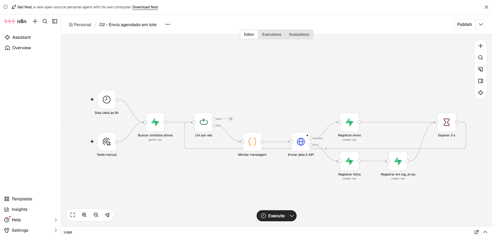

# Automação de WhatsApp com n8n, Z-API Omni e Supabase

Envio de mensagens de WhatsApp personalizadas para contatos guardados no Supabase, de dois jeitos: fluxos no n8n (sob demanda por webhook e em lote agendado) e um script Python equivalente. Os envios e os erros ficam registrados no banco, e o ambiente sobe com Docker Compose.



## Arquitetura

```
                 ┌──────────── Docker Compose ────────────┐
                 │  n8n                                    │
 POST webhook ──►│   01 Envio por webhook ─────┐           │
                 │   02 Lote agendado ─────────┼──► Z-API ─┼──► WhatsApp
                 │   03 Registro de erros      │           │
                 │                             │           │
                 │  envio-python (sob demanda) ┘           │
                 └──────────────┬──────────────────────────┘
                                │ lê contatos, grava envios e erros
                                ▼
                        Supabase (PostgreSQL)
```

| Tabela | Uso |
| --- | --- |
| `contatos` | Nome, telefone (DDI 55 + DDD + número) e se está ativo |
| `envios` | Histórico de cada envio, com telefone já mascarado e o `messageId` da Z-API |
| `log_erros` | Falhas do n8n e do Python |

## Z-API Omni

O envio usa a API da [Z-API Omni](https://developer.omni.z-api.io) com um canal do tipo WhatsApp Web (`Z_API_WHATSAPP`), conectado por QR code:

```
POST https://api.omni.z-api.io/v1/channels/{OMNI_CHANNEL_ID}/messages
Authorization: Bearer {OMNI_SECRET_KEY}

{ "recipient": { "identifier": "5551999999999" },
  "content": { "type": "TEXT", "body": { "message": "Olá!" } } }
```

Nesse tipo de canal não há janela de 24 horas nem templates, então o envio funciona a qualquer momento.

## Fluxos n8n

- **01 Envio por webhook**: `POST /webhook/enviar-mensagem` com `{"nome": "...", "telefone": "..."}`. Valida o telefone, sanitiza o nome, envia e responde com o `messageId`. Dados inválidos voltam com status 400.
- **02 Envio agendado em lote**: dias úteis às 9h, busca até `LIMITE_LOTE` contatos ativos e envia um por vez, com 3 segundos entre os envios. Uma falha não interrompe o lote: vai para `envios` com status `erro` e para `log_erros`.
- **03 Registro de erros**: Error Workflow dos outros dois. Qualquer erro não tratado vira uma linha em `log_erros`.

## Script Python

`python/main.py` faz o mesmo que o lote: lê os contatos ativos, monta a mensagem e envia pela Z-API.

- Valida as variáveis de ambiente antes de começar e lista as que faltam, sem mostrar valores.
- Telefones aparecem mascarados nos logs e no banco (`5551*****4321`).
- Nomes passam por sanitização: só letras, espaço, hífen e apóstrofo, até 40 caracteres.
- Com `DRY_RUN=true`, só mostra as mensagens no log, sem enviar.
- Um erro em um contato não para os outros; no fim mostra o resumo e sai com código 1 se houve falha.

## Configuração

Pré-requisitos: Docker, uma conta no [Supabase](https://supabase.com) e uma conta na [Z-API Omni](https://z-api.io) com um canal WhatsApp conectado por QR code.

1. No SQL Editor do Supabase, rode `supabase/schema.sql` e depois `supabase/seed.sql` (troque os telefones do seed pelo seu número).
2. Copie o arquivo de ambiente e preencha:
   ```
   cp .env.example .env
   ```
3. Suba o n8n:
   ```
   docker compose up -d
   ```
4. Importe os fluxos:
   ```
   docker compose exec n8n n8n import:workflow --separate --input=/home/node/fluxos
   ```
5. Em http://localhost:5678, crie as credenciais e selecione-as nos nós:
   - **Supabase API**: URL do projeto e chave `service_role`
   - **Header Auth**: nome `Authorization`, valor = `Bearer ` seguido da sua Secret Key da Z-API Omni
6. Publique (ative) os fluxos 01 e 02.

## Como testar

Webhook:

```
curl -X POST http://localhost:5678/webhook/enviar-mensagem \
  -H "Content-Type: application/json" \
  -d '{"nome": "Arthur", "telefone": "5551999999999"}'
```

Lote: abra o fluxo 02 e clique em executar pelo gatilho "Teste manual".

Python, primeiro sem enviar e depois de verdade (mude `DRY_RUN` para `false` no `.env`):

```
docker compose run --rm envio-python
```

Testes automatizados:

```
pip install -r python/requirements.txt
pytest
```

## Segurança

- Chaves e tokens só no `.env` (fora do git) e nas credenciais do n8n; os JSON dos fluxos não têm nenhum segredo.
- A chave `service_role` do Supabase fica só no backend. RLS está habilitado nas três tabelas, sem políticas públicas.
- Telefones mascarados em logs e no histórico; nomes sanitizados antes de entrar na mensagem.
- O n8n precisa de `N8N_BLOCK_ENV_ACCESS_IN_NODE=false` para ler o ID do canal nas expressões. É uma escolha para ambiente local; a Secret Key fica numa credencial do n8n, nunca no fluxo.

## Decisões e limitações

- O lote envia no máximo 3 contatos por padrão e espera 3 segundos entre envios, para não arriscar bloqueio do número por disparo em massa.
- Envio só de texto; mídia e respostas recebidas ficam fora do escopo.
